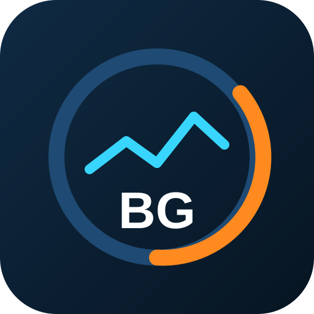
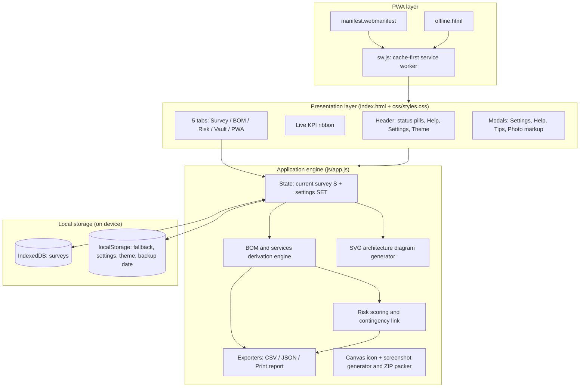
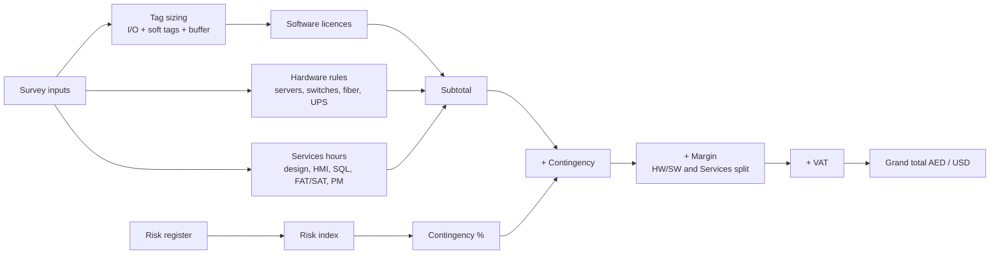

<p align="center">
  
</p>

<h1 align="center">BOM-Genius Surveyor</h1>

<p align="center">
  Offline-first site survey, Wonderware / AVEVA SCADA BOM &amp; services estimator, and risk analyzer.<br>
  Built for Al Gurg Automation and Controls (Dubai, U.A.E.) &mdash; fully editable for any company.
</p>

<p align="center">
  
  &nbsp;<b>Vanilla HTML5 + CSS3 + ES6 &middot; No framework &middot; No CDN &middot; No server &middot; Works offline</b>
</p>

---

## 1. What it is

BOM-Genius Surveyor is a Progressive Web App (PWA) that an automation engineer uses during a plant walkdown. You enter what you see on site (PLCs, protocols, I/O, distances, client stations, screens, database needs). The app then:

1. Sizes the Wonderware / AVEVA licence tier.
2. Builds a categorised **Bill of Materials** (software, hardware, services).
3. Derives **engineering man-hours** for every phase.
4. Scores **risks and QHSE hazards**, which sets the **contingency %**.
5. Applies **margins and VAT** and gives a grand total in AED or USD.
6. Exports **CSV**, **JSON**, and a printable **A4 PDF report**.

Everything runs inside the browser on the device. Surveys are stored locally and the app keeps working with no connection.

> Unit prices and hourly rates shipped with the app are **editable placeholders**, not quotations. Replace them with real vendor prices in **Settings**.

---

## 2. Features at a glance

| Tab | Purpose | Highlights |
| --- | --- | --- |
| **1 Survey** | Site audit input | Collapsible sections with summary pills, large &minus; / + steppers, +5/+10/+50 quick pills, quick-start presets, live sizing summary, auto-drawn architecture diagram, assumptions &amp; exclusions, site photos with finger markup |
| **2 BOM** | Estimate | Auto BOM + services, editable qty and unit price per line, manual line items, split margins, VAT, AED/USD toggle, stacked cost-distribution bar |
| **3 Risk** | Risk &amp; QHSE | Likelihood x Impact scoring, 5x5 colour heatmap, category filters, auto-mitigation text, risk index linked to contingency, opportunities log |
| **4 Vault** | Storage &amp; export | Save / load / duplicate / delete surveys, CSV export, JSON export and import, backup-all, printable PDF report, backup status |
| **5 PWA** | Install &amp; assets | Install-readiness checks, storage lock status, in-browser icon / screenshot generator with ZIP download |

Header tools available on every tab: **? Help** guide, **&#9881; Settings** (branding, defaults, master price book), **theme toggle** (Control Room Dark / Dubai Sunlight), save and network status, and a live **KPI ribbon** (tags, grand total, hours, risk level, auto-save).

---

## 3. System architecture

### 3.1 Application layers



### 3.2 Calculation flow (one survey to one price)



### 3.3 Typical SCADA architecture drawn by the app

The Survey tab draws this automatically from your inputs and prints it in the report.

```
 L3   Clients     [ Operator WS xN ] [ Engineering WS xN ] [ RDS / Web xN ] [ Touch PCs xN ]
                              |                |                  |              |
 L3   SCADA       [ App / IO Server (InTouch or System Platform)  x2 if redundant ]
      servers     [ AVEVA Historian + SQL                         x2 if redundant ]
                              |
 L3.5 Network     [ Industrial firewall (HA pair if redundant) ] [ Managed switches (ring?) ]
      / DMZ                   |   Cat6A up to 90 m, OS2 fiber + SFP beyond 90 m
                              |
 L2   Control     [ Protocols: OPC UA / Modbus / Profinet / EtherNet/IP / BACnet / IEC 61850 ]
      network     [ Protocol gateways (Modbus RTU to TCP/OPC) ]
                              |
 L1   Field       [ PLCs / RTUs (Allen-Bradley, Siemens, Schneider...) ] [ I/O and tag summary ]
```

### 3.4 Offline model

| Concern | How it works |
| --- | --- |
| App shell | `sw.js` precaches core files at install (cache-first, network fallback) |
| Icons / screenshots | Cached individually, so a missing image never breaks installation |
| Offline navigation | Falls back to cached `index.html`, then `offline.html` |
| Updates | Versioned caches (`bomgenius-shell-vX.Y.Z`); old versions are deleted on activate |
| Survey data | IndexedDB (falls back to localStorage) on the device |
| Persistence | App requests `navigator.storage.persist()`; status badge shows the result |

---

## 4. Functions in detail

### 4.1 Survey audit (Tab 1)

* **Project header:** project, client, location, survey date, engineer, estimation reference.
* **Field and PLC audit:** PLC/RTU count and brands; protocols (OPC UA, OPC DA, Modbus TCP, Modbus RTU RS-485, Profinet, EtherNet/IP, BACnet, IEC 61850); digital in/out, analog in/out, soft/calculated tags.
* **Network and site:** control-room distance, panel free space, ambient temperature / cooling, power and UPS.
* **SCADA architecture:** standalone InTouch or distributed AVEVA System Platform; redundant app/IO servers, redundant historian, ring topology.
* **Client stations:** operator, engineering, remote RDS/web, industrial touch panel PCs.
* **HMI scope:** low / medium / high complexity screens, alarm and trend screens, scripting level.
* **Database and reporting:** Historian + SQL, custom queries, automated reports.
* **Presets:** Standalone InTouch skid, Redundant System Platform plant, Dubai utility substation, and a sample Dubai water station survey.
* **Photos:** capture or add photos, draw pen / circle / arrow in red or yellow, undo / clear, save compressed copies offline.

### 4.2 BOM and services engine (Tab 2)

**Software and licensing**

* Tag tier is the smallest of 500, 1,000, 2,500, 5,000, 10,000, 25,000, 60,000+ that fits total tags plus the spare buffer (default 20%).
* Development studio, OI Server / OPC / Modbus drivers (one per selected protocol), Application Server (System Platform), Historian + SQL, client licences, SQL/Windows CALs.

**Hardware and network**

* Servers (doubled where redundancy is selected), rack, operator and engineering PCs, dual monitors, touch panel PCs.
* Switches sized 8 / 16 / 24 ports from node count; a ring adds one switch.
* Distance over 90 m switches Cat6A to OS2 fiber with SFP modules.
* Modbus RTU adds protocol gateways, firewall (HA pair if redundant), UPS, cooling for hot rooms, new enclosure when no panel space.

**Engineering services (man-hours x hourly rate)**

| Service | Driver |
| --- | --- |
| System design, FDS/DDS | base + PLCs + protocols + architecture + redundancy |
| HMI graphics, alarms, trends | 4 / 8 / 16 h per low / medium / high screen + 6 h per alarm/trend screen |
| Scripting and debugging | scripting level + tag count |
| SQL integration | historian + queries + reports |
| OPC / Modbus / PLC integration | PLCs + protocols + tags |
| FAT, SAT and commissioning, training | HMI size, PLC count, number of users |
| Project management | 12% of engineering hours + 8 h |
| QHSE and legal documentation | 4% of engineering hours + 6 h |

**Commercial**

* Edit any quantity or unit price per line; reset to auto with one tap; add manual lines.
* Contingency: automatic from the risk index, or manual.
* Separate margins for hardware/software (default 12%) and services (default 25%).
* VAT (default UAE 5%), AED / USD toggle with editable rate (default 3.6725).
* Stacked bar shows software, hardware, services, contingency, margin and VAT as a share of the grand total.

### 4.3 Risk, opportunity and QHSE (Tab 3)

* Pre-loaded register covering technical, commercial and QHSE risks (QHSE per **Annexure-SCT-HR-001**: LOTO, heat stress, work at height, ATEX, PPE and permit-to-work).
* Score = Likelihood (1-5) x Impact (1-5), with an automatic action for each band.
* 5x5 heatmap (green / yellow / orange / red) with category filters.
* Project risk index drives contingency: average score under 5 = 3%, under 9 = 5%, under 13 = 8%, under 17 = 12%, otherwise 15%; plus 2% if any single risk scores 20 or more.
* Opportunities log for upsell items (legacy migration, energy dashboards, mobile web HMI, AMC).

### 4.4 Vault and export (Tab 4)

* Save, load, duplicate and delete surveys; auto-save on every change.
* **CSV** of the full BOM and services for the estimation team (Excel-ready, UTF-8).
* **JSON** export and import of one project, plus **Backup ALL surveys**.
* **Print report** (use *Save as PDF*, A4, background graphics on): cover header, survey audit, architecture diagram, categorised BOM, man-hour breakdown, commercial summary, assumptions and exclusions, risk matrix, opportunities, site photos, signature blocks.
* Data-safety card shows storage status, usage, and the date of the last backup.

### 4.5 Settings and help

* **Settings:** company name, location, default engineer, reference prefix, tag buffer, default margins, tax label and %, exchange rate, and a **master price book** (every licence tier, hardware item and hourly rate). Includes reset buttons and export / import of settings JSON.
* **Help:** 5-step walkdown guide, how the BOM math works, install and backup instructions. ⓘ tips open as dismissible dialogs.

---

## 5. File structure

```
bom-genius-pwa/
├── index.html                 App shell, iOS meta tags, header, tabs, KPI ribbon
├── manifest.webmanifest       Install metadata, icons, screenshots, shortcuts
├── sw.js                      Service worker (cache-first, offline fallback, versioned)
├── offline.html               Self-contained offline page
├── favicon.svg                Vector SCADA emblem
├── robots.txt
├── css/
│   └── styles.css             Two themes, responsive layout, print (A4) styles
├── js/
│   └── app.js                 State, BOM engine, risk, vault, exports, settings, help,
│                              photo markup, SVG diagram, icon generator, ZIP packer
├── icons/                     icon-72 ... icon-512, maskable 192/512,
│                              apple-touch-icon, favicon-16x16, favicon-32x32
└── screenshots/               screenshot-wide.png, screenshot-narrow.png
```

---

## 6. Install and run

**On a computer (test):**

```bash
cd bom-genius-pwa
npx serve .
# open the printed http://localhost URL
```

**On a phone or tablet:** host the folder on any free static HTTPS host (GitHub Pages, Cloudflare Pages, Netlify), open the link once, then:

* **Android (Chrome):** menu, then *Install app* / *Add to Home screen*.
* **iPhone / iPad (Safari):** Share, then *Add to Home Screen*.

> Opening `index.html` directly from a file manager (`file://`) cannot run the service worker, so offline mode needs `localhost` or HTTPS.

**After updating files on a host:** reload once or twice (or reopen the installed app) so the new service-worker version takes over.

---

## 7. Data safety

* Surveys live **inside the browser** on the device. Clearing site data, uninstalling, or losing the device erases them.
* Use **Backup ALL surveys (JSON)** in the Vault regularly. The Vault shows the date of the last backup and warns after 7 days.
* The app requests persistent storage; the header badge shows **Storage Locked ✓** when the browser agrees. Browsers may decline.
* Installing to the Home Screen helps protect data on iOS.

---

## 8. Customising without code

Open **&#9881; Settings** to change branding, defaults and prices; they are saved on the device. Settings can be exported to JSON and imported on another device. The default company name, tier prices and hourly rates also live in `js/app.js` if you ever need to change the factory values.

---

## 9. Verification status

* The BOM and risk calculations, tab rendering, settings, help and storage code were exercised in an automated simulated-browser test with no errors.
* **Not yet verified in a real browser:** installation, offline reload, photo markup by touch, mobile bottom-navigation layout, and the A4 PDF layout. Run this once before field use:
  1. Serve over `localhost` / HTTPS and reload.
  2. DevTools, Network, set *Offline*, refresh: the app should still load.
  3. Add a photo, draw on it, save, refresh: it should persist.
  4. Print report, Save as PDF (A4, background graphics): check the diagram, tables and photos fit.

---

## 10. Technology and limits

* HTML5, CSS3, vanilla ES6+ JavaScript. IndexedDB, localStorage, Service Worker, Canvas, Web App Manifest.
* No external libraries, CDNs, APIs or accounts.
* Prices, hours formulas and risk-to-contingency bands are engineering starting points; review them against your company standards before issuing quotations.

<p align="center"><sub>BOM-Genius Surveyor &middot; Al Gurg Automation and Controls &middot; Dubai, U.A.E.</sub></p>
